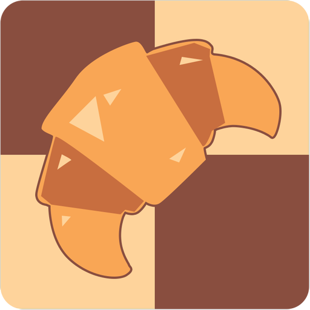

<br />
<div align="center">
  <a href="https://github.com/Cuteesy/ChessLab">
    
  </a>

  <h3 align="center">ChessLab</h3>

  <p align="center">
    A Stockfish-powered chess analysis workspace for the desktop
    <br />
    <a href="https://github.com/Cuteesy/ChessLab/issues">Report a bug</a>
    ·
    <a href="app/CONTRIBUTING.md">Contributing</a>
    ·
    <a href="#building-from-source">Build from source</a>
  </p>
</div>

[](https://github.com/Cuteesy/ChessLab/actions/workflows/build-linux.yml)
[](LICENSE)

ChessLab is an open-source desktop application for studying chess with a local
engine. Analysis, game databases, repertoires and puzzles live in a single
native window, and every evaluation comes from Stockfish running on your own
machine, with no analysis server and no upload.

ChessLab is a GPL-3.0 fork of [En Croissant](https://github.com/franciscoBSalgueiro/en-croissant),
extended with coach mode, board-level threat arrows, human-like engine strength
and a floating analysis board.

## Features

**Analysis**

- Multi-PV Stockfish analysis with configurable engine management and UCI options
- Coach mode: surfaces the best move only for the side you are playing
- Threat arrows: highlights the opponent's strongest reply to a position
- Human-like strength: caps the engine with `UCI_LimitStrength`, `UCI_Elo` and
  `Skill Level` so sparring partners play plausibly
- Move classification and accuracy reports for reviewed games

**Practice**

- Opening explorer and repertoire preparation
- Spaced-repetition puzzle training
- Local game databases with position search, player merge and PGN import/export

**Desktop integration**

- Frameless, always-on-top floating board that mirrors the analysis window
- Native file dialogs, deep links (`chesslab://import?url=...`) and single-instance
  handling, so opening a PGN reuses the running window
- Engines run as local processes; analysis works without network access

## Requirements

- [Tauri prerequisites](https://tauri.app/start/prerequisites/) for your platform
- Node.js 22 or newer, with pnpm 12.15.0 through [corepack](https://pnpm.io/installation)
- Rust stable

On Debian and Ubuntu the system packages used by the Linux build are:

```bash
sudo apt install build-essential cmake ninja-build pkg-config patchelf file \
  libwebkit2gtk-4.1-dev libgtk-3-dev libayatana-appindicator3-dev \
  librsvg2-dev libssl-dev libxdo-dev
```

## Building from source

```bash
git clone https://github.com/Cuteesy/ChessLab
cd ChessLab/app
corepack pnpm install
corepack pnpm tauri dev
```

To produce a release build:

```bash
corepack pnpm tauri build --bundles deb
```

The packaged application is written to `app/src-tauri/target/release/bundle/deb`,
and the raw executable to `app/src-tauri/target/release/chesslab`.

The frontend checks can be run on their own:

```bash
corepack pnpm exec tsc --noEmit
corepack pnpm test
corepack pnpm build-vite
```

A Stockfish binary is bundled at `stockfish/stockfish` for Linux; ChessLab
detects it automatically when it is not already on `PATH`.

## Continuous integration

The `build-linux-deb` workflow builds the Linux package on a GitHub-hosted
runner for every push to `main` that touches `app/`. It uploads two artifacts,
`chesslab-linux-deb` and `chesslab-linux-binary`, which can be fetched with:

```bash
gh run download -n chesslab-linux-deb
```

## Repository layout

- `app/` — the current desktop application (Tauri 2, React, TypeScript, Rust)
- `chesslab/` — the legacy Python/Tkinter implementation, kept as a behaviour
  reference until feature parity is verified
- `stockfish/` — bundled engine binary used by `run.sh` and development runs
- `install.sh`, `run.sh` — installer and launcher for the legacy Python build

## Contributing

Bug reports and pull requests are welcome. Please read the
[contributing guide](app/CONTRIBUTING.md) before opening a pull request.

## Credits

ChessLab builds on [En Croissant](https://github.com/franciscoBSalgueiro/en-croissant)
by Francisco Salgueiro and contributors, and on [Stockfish](https://stockfishchess.org/)
for analysis. Chess piece sets and board themes ship under their own licenses.

## License

ChessLab is distributed under the GNU General Public License, version 3 only.
See [LICENSE](LICENSE) for the full text. En Croissant is copyright its
contributors and is also licensed under GPL-3.0-only.
