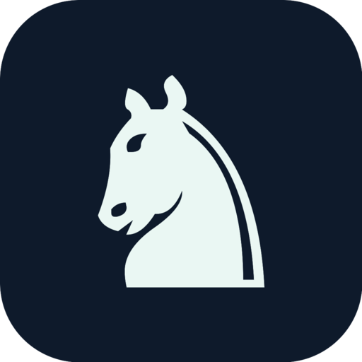

<br />
<div align="center">
  <a href="https://github.com/Cuteesy/ChessLab">
    
  </a>

  <h3 align="center">ChessLab</h3>

  <p align="center">
    A Stockfish-powered chess analysis workspace for the desktop
    <br />
    <a href="https://github.com/Cuteesy/ChessLab/issues">Report a bug</a>
    ·
    <a href="app/CONTRIBUTING.md">Contributing</a>
    ·
    <a href="#development">Build from source</a>
  </p>
</div>

[](https://github.com/Cuteesy/ChessLab/actions/workflows/build-linux.yml)
[](LICENSE)

ChessLab is an open-source desktop application for studying chess with a local
engine. Analysis, game databases, repertoires and puzzles share one native
window, and every evaluation comes from Stockfish on your own machine — no
analysis server, no upload.

It is a GPL-3.0 fork of [En Croissant](https://github.com/franciscoBSalgueiro/en-croissant)
that adds a coach mode, board-level threat arrows, human-like engine strength
and a floating analysis board, and drops upstream's telemetry and updater.

## What the fork adds

| | |
|---|---|
| **Coach mode** | Surfaces the best move only for the side you are playing, instead of both |
| **Human-like engine** | Caps Stockfish at `UCI_LimitStrength`, `UCI_Elo 1800` and `Skill Level 15`, and lifts the cap again when you switch it off |
| **Floating board** | Frameless, always-on-top window that mirrors the board; opening it again focuses the existing window |
| **Threat arrows** | Paints the opponent's strongest reply directly on the board |
| **No telemetry** | Upstream's analytics and self-updater are not included; builds are installed explicitly |

## Features

**Analysis**

- Multi-PV Stockfish analysis with per-engine UCI configuration
- Move classification and accuracy reports for reviewed games
- Import a position from an image using the bundled vision model

**Practice**

- Opening explorer and repertoire preparation
- Spaced-repetition puzzle training
- Local game databases with position search, player merge and PGN import/export

**Desktop**

- Import games from lichess.org and chess.com
- Native file dialogs, single-instance handling and `chesslab://import?url=...` deep links
- Local sound server, board and piece themes, rebindable keyboard shortcuts

## Requirements

- [Tauri prerequisites](https://tauri.app/start/prerequisites/) for your platform
- Node.js 22 or newer, with pnpm 12.15.0 through [corepack](https://pnpm.io/installation)
- Rust stable

Debian and Ubuntu also need the packages used by the Linux build:

```bash
sudo apt install build-essential cmake ninja-build pkg-config patchelf file \
  libwebkit2gtk-4.1-dev libgtk-3-dev libayatana-appindicator3-dev \
  librsvg2-dev libssl-dev libxdo-dev
```

## Development

```bash
git clone https://github.com/Cuteesy/ChessLab
cd ChessLab/app
corepack pnpm install
corepack pnpm tauri dev
```

Run the frontend checks before opening a pull request:

```bash
corepack pnpm exec tsc --noEmit
corepack pnpm test
```

## Packaging

```bash
cd app
corepack pnpm tauri build --bundles deb
```

The package is written to `app/src-tauri/target/release/bundle/deb` and the raw
executable to `app/src-tauri/target/release/chesslab`.

The `build-linux-deb` workflow runs this build on a GitHub-hosted runner for
every push to `main` that touches `app/`, and uploads two artifacts:

```bash
gh run download -n chesslab-linux-deb
```

A Stockfish binary is bundled at `stockfish/stockfish` for Linux; ChessLab picks
it up automatically when it is not already on `PATH`.

## Project structure

| Path | Contents |
|---|---|
| `app/` | Desktop application: Tauri 2, React, TypeScript, Rust |
| `chesslab/` | Legacy Python implementation, kept as a behaviour reference |
| `stockfish/` | Bundled Linux engine binary |
| `branding/` | Logo source and raster renders |
| `install.sh`, `run.sh` | Installer and launcher for the legacy Python build |

## Contributing

Bug reports and pull requests are welcome. Read the
[contributing guide](app/CONTRIBUTING.md) before opening a pull request.

## Credits and license

ChessLab builds on [En Croissant](https://github.com/franciscoBSalgueiro/en-croissant)
by Francisco Salgueiro and contributors, and on [Stockfish](https://stockfishchess.org/).
Bundled chess piece sets and board themes ship under their own licenses.

ChessLab is distributed under the GNU General Public License, version 3 only.
See [LICENSE](LICENSE) for the full text.
